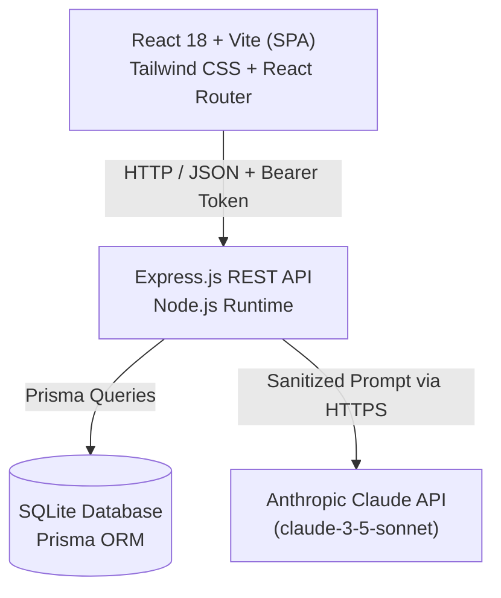
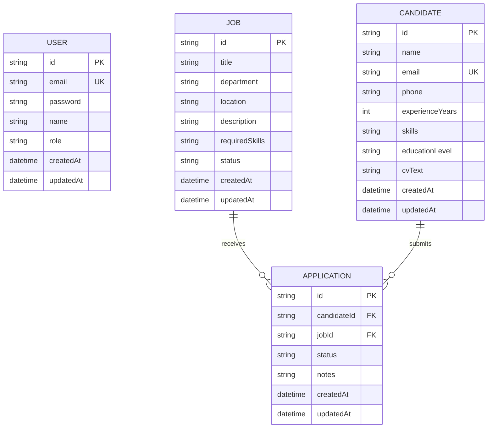

# Technical Report: TalentFlow - AI-Powered Recruitment Management Platform

---

## 1. Cover Page
- **Project Title**: TalentFlow - Modern Recruitment Platform with Privacy-Preserving AI
- **Course**: Web Development & Applied Artificial Intelligence (Mini-Project)
- **Academic Year**: 2026-2027
- **Author**: **Eya Ezdine** - `eyaezdine@gmail.com`
- **Role**: Full-Stack Engineer & AI Architect
- **Supervising Professor**: [Teacher Name]
- **Submission Date**: [Date]

---

## 2. Introduction & Objectives
In modern human resources management, talent acquisition teams are inundated with hundreds of unstructured candidate profiles per job opening. Traditional recruitment workflows suffer from cognitive fatigue, inconsistent candidate screening, and delays in identifying best-fit profiles.

The objective of **TalentFlow** is to build a modern, high-performance web application combining full-stack CRUD capabilities (Job postings, Candidate profiles, and Application Kanban pipelines) with privacy-compliant, fault-tolerant Artificial Intelligence powered by Claude API. The application adheres to rigorous architectural principles, including client-side zero-leakage PII anonymization (Rule R1), strict JSON schema validation (Rule R2), robust fault handling (Rule R3), and version-controlled prompt templates (Rule R4).

---

## 3. Project Description & Features
TalentFlow provides:
- **Role-Based Access Control**: Secure JWT-based access for `ADMIN` (full control) and `RECRUITER` roles.
- **Job Offer Management**: Complete lifecycle tracking (Draft, Open, Closed) with required skills tags.
- **Candidate Profiles**: Structured CV ingestion storing contact information, education, experience, and raw CV text.
- **Recruitment Pipeline**: Kanban-style status tracking (`New` -> `Screening` -> `Interview` -> `Offer` -> `Rejected`).
- **HR Dashboard**: Real-time KPI summaries and dynamic chart breakdown of application stages.
- **Three Intelligent AI Assistants**:
  1. *Candidate Summary*: Generates a 3-sentence professional executive summary and top skill keywords.
  2. *Job Fit Matcher*: Computes a 0-100 compatibility score, highlights key strengths and missing competencies, and returns a hiring recommendation.
  3. *Interview Preparation Assistant*: Dynamically generates 5 targeted technical and situational questions based on the candidate's unique gaps.

---

## 4. Requirements Specification & User Roles

### 4.1 Functional Requirements (FR)
- **FR-1**: Users must authenticate via email and password with JWT token persistence.
- **FR-2**: Recruiters can create, read, update, and delete job postings and candidates.
- **FR-3**: Applications link candidate profiles to job offers with state transitions.
- **FR-4**: Search and filter records by keyword, experience level, and status with pagination.
- **FR-5**: Anonymized candidate data can be analyzed by Claude AI on demand.

### 4.2 Non-Functional Requirements (NFR)
- **NFR-1 (Privacy)**: No raw personal data (names, email addresses, phone numbers) may ever leave the server to external LLM providers.
- **NFR-2 (Resilience)**: AI API failures (timeouts, rate limits, network faults) must degrade gracefully within 15 seconds without crashing the core app.
- **NFR-3 (Performance)**: Paginated queries must respond in under 200ms on a local SQLite instance.
- **NFR-4 (Security)**: Passwords must be salted with bcrypt (10 rounds). Protected API routes must verify JWT tokens.

---

## 5. System Architecture & Folder Structure

### 5.1 Front-End SPA Routing & Guards
- **Public Routes**: `/login`, `/register` (redirect to `/dashboard` if token already stored).
- **Protected Layout Shell**: Enforced by `<ProtectedRoute />` checking `isAuthenticated` from `AuthContext`:
  - `/dashboard`: Metrics KPI cards & application status charts.
  - `/jobs`: Job offers catalog and creation dialogs.
  - `/candidates`: Candidate directory and CV inspection.
  - `/applications`: 5-column Kanban recruitment pipeline.
- **Axios Interceptors**: Automatically injects `Authorization: Bearer <token>` into outgoing requests and traps HTTP 401 to clear local session and redirect gracefully to login.

---

## 6. Technology Choices & Justification
- **React + Vite**: Instant hot-module replacement (HMR), lightweight bundle size, and component reusability.
- **Tailwind CSS**: Rapid utility-first styling with zero runtime overhead and unified color system.
- **Node.js & Express**: Event-driven I/O model ideal for asynchronous API orchestration and streaming.
- **SQLite + Prisma ORM**: Zero-configuration, file-based relational database ideal for demo isolation and automated migrations with strict type safety.
- **Anthropic Claude API**: Superior reasoning capability for structured recruitment analysis and native JSON output support.
- **Zod**: Declarative runtime schema validation for both incoming HTTP payloads and LLM JSON outputs.

---

## 7. Database Design (ER Diagram)

### 7.1 Entity-Relationship Diagram

### 7.2 Table Descriptions
- **`users`**: Manages recruitment staff accounts, with `role` distinguishing `ADMIN` (system configuration and user management) from `RECRUITER` (job and candidate management).
- **`jobs`**: Tracks recruitment campaigns, status transitions (`DRAFT`, `OPEN`, `CLOSED`), and required technical skill sets.
- **`candidates`**: Stores applicant resumes, years of experience, education levels, and full CV text for processing.
- **`applications`**: Association table linking a Candidate with a Job. Enforces a compound unique constraint on `(candidateId, jobId)` and tracks recruitment pipeline stages (`NEW`, `SCREENING`, `INTERVIEW`, `OFFER`, `REJECTED`).

---

## 8. REST API Documentation

### 8.1 Authentication Endpoints (Phase 1)

| Method | Endpoint | Access / Auth | Request Body | Success Response | Status |
|:---|:---|:---|:---|:---|:---|
| `GET` | `/api/health` | Public | None | `{ status: "ok", service: "TalentFlow API" }` | 200 OK |
| `POST` | `/api/auth/register` | Public | `{ name, email, password, role? }` | `{ message, user: { id, name, email, role }, token }` | 201 Created |
| `POST` | `/api/auth/login` | Public | `{ email, password }` | `{ message, user: { id, name, email, role }, token }` | 200 OK |
| `GET` | `/api/auth/me` | Bearer JWT | None | `{ user: { id, name, email, role } }` | 200 OK |

### 8.2 Job Offers Endpoints (Phase 2)

| Method | Endpoint | Access / Auth | Query / Body | Success Response | Status |
|:---|:---|:---|:---|:---|:---|
| `GET` | `/api/jobs` | Bearer JWT | `?page=1&limit=10&search=&status=&department=` | `{ data: [...], pagination: { total, page, limit, totalPages } }` | 200 OK |
| `GET` | `/api/jobs/:id` | Bearer JWT | None | `{ data: { ...job, applications: [...] } }` | 200 OK |
| `POST` | `/api/jobs` | Bearer JWT | `{ title, department, location, description, requiredSkills, status }` | `{ message, data: job }` | 201 Created |
| `PUT` | `/api/jobs/:id` | Bearer JWT | `{ title?, department?, location?, description?, requiredSkills?, status? }` | `{ message, data: updatedJob }` | 200 OK |
| `DELETE` | `/api/jobs/:id` | ADMIN Role | None | `{ message, id }` | 200 OK |

### 8.3 Candidates Endpoints (Phase 2)

| Method | Endpoint | Access / Auth | Query / Body | Success Response | Status |
|:---|:---|:---|:---|:---|:---|
| `GET` | `/api/candidates` | Bearer JWT | `?page=1&limit=10&search=&minExperience=&educationLevel=` | `{ data: [...], pagination: { total, page, limit, totalPages } }` | 200 OK |
| `GET` | `/api/candidates/:id` | Bearer JWT | None | `{ data: { ...candidate, applications: [...] } }` | 200 OK |
| `POST` | `/api/candidates` | Bearer JWT | `{ name, email, phone, experienceYears, skills, educationLevel, cvText }` | `{ message, data: candidate }` | 201 Created |
| `PUT` | `/api/candidates/:id` | Bearer JWT | Partial candidate fields | `{ message, data: updatedCandidate }` | 200 OK |
| `DELETE` | `/api/candidates/:id` | ADMIN Role | None | `{ message, id }` | 200 OK |

### 8.4 Applications Pipeline Endpoints (Phase 2)

| Method | Endpoint | Access / Auth | Query / Body | Success Response | Status |
|:---|:---|:---|:---|:---|:---|
| `GET` | `/api/applications` | Bearer JWT | `?page=1&limit=10&status=&jobId=&candidateId=` | `{ data: [...], pagination: { total, page, limit, totalPages } }` | 200 OK |
| `GET` | `/api/applications/:id` | Bearer JWT | None | `{ data: { ...application, candidate, job } }` | 200 OK |
| `POST` | `/api/applications` | Bearer JWT | `{ candidateId, jobId, status?, notes? }` | `{ message, data: application }` | 201 Created |
| `PUT` | `/api/applications/:id/status` | Bearer JWT | `{ status: "NEW"\|"SCREENING"\|"INTERVIEW"\|"OFFER"\|"REJECTED", notes? }` | `{ message, data: application }` | 200 OK |
| `DELETE` | `/api/applications/:id` | ADMIN Role | None | `{ message, id }` | 200 OK |

### 8.5 Dashboard Analytics Endpoints (Phase 2)

| Method | Endpoint | Access / Auth | Query / Body | Success Response | Status |
|:---|:---|:---|:---|:---|:---|
| `GET` | `/api/dashboard/stats` | Bearer JWT | None | `{ data: { counters: { totalJobs, openJobs, totalCandidates, totalApplications }, pipelineBreakdown: { NEW, SCREENING, INTERVIEW, OFFER, REJECTED }, recentApplications: [...] } }` | 200 OK |

---

## 9. AI Module Engineering & Compliance
*(Detailed in Phase 5)*
- **Models**: `claude-3-5-sonnet-20241022` (configurable via `AI_MODEL` environment variable)
- **Temperature**: `0.2` for deterministic, grounded HR assessments
- **Max Tokens**: `1000`

---

## 10. Security & Privacy Considerations
- Compliance with Rule R1 (Zero-leakage PII masking).
- JWT signed with HS256 algorithm and 24-hour expiration.
- Secrets isolated strictly in `.env`.

---

## 11. Testing Strategy & Results
*(Detailed in Phase 6)*

---

## 12. Git Workflow & Development Tracking
The project follows clean Git discipline:
- Conventional Commits (`feat:`, `fix:`, `docs:`, `chore:`, `test:`, `refactor:`)
- Small, focused, atomic commits
- Traceable issues and milestones. See `docs/CONTRIBUTIONS.md` for complete feature tracking.

---

## 13. Cloud Deployment
*(Detailed in Phase 7)*

---

## 14. Difficulties Encountered & Solutions
*(Maintained iteratively across phases)*

---

## 15. Conclusion & Future Work
*(Detailed in Phase 8)*

---

## 16. Annex: User Guide & Screenshots Tracker

All 20 mandatory defense screenshots are tracked below and linked to their implementation phases:

| # | Screenshot ID / File Name | Implementation Phase | Interface / State Captured | Report Figure Caption |
|:---|:---|:---|:---|:---|
| **01** | `01-login-page.png` | Phase 3 | User Login Screen | *Figure 01: TalentFlow user authentication portal with client validation.* |
| **02** | `02-register-page.png` | Phase 3 | User Registration Screen | *Figure 02: Account registration screen with role-based access assignment.* |
| **03** | `03-dashboard-with-chart.png` | Phase 4 | Dashboard View | *Figure 03: HR recruitment dashboard displaying KPI counters and pipeline distribution chart.* |
| **04** | `04-job-offers-list.png` | Phase 4 | Job Offers Catalog | *Figure 04: Paginated job postings with search, department filtering, and applicant volume counters.* |
| **05** | `05-job-creation-form.png` | Phase 4 | Job Creation Dialog | *Figure 05: Modal form for publishing new job openings with skill tags and validation.* |
| **06** | `06-candidate-list-search-filter.png` | Phase 4 | Candidate Directory | *Figure 06: Candidate repository featuring keyword search, experience filtering, and pagination.* |
| **07** | `07-candidate-detail-profile.png` | Phase 4 | Candidate Profile & CV | *Figure 07: Detailed applicant inspection modal displaying qualifications and raw CV text.* |
| **08** | `08-application-kanban-pipeline.png` | Phase 4 | Kanban Pipeline Board | *Figure 08: Interactive 5-column recruitment pipeline tracking candidate progression across stages.* |
| **09** | `09-ai-summary-loading-state.png` | Phase 5 | AI Loading Spinner | *Figure 09: Asynchronous loading feedback during Claude AI executive summary generation.* |
| **10** | `10-ai-summary-result.png` | Phase 5 | AI Summary Modal | *Figure 10: Validated 3-sentence professional candidate summary with technical keywords.* |
| **11** | `11-ai-matching-result.png` | Phase 5 | AI Compatibility Match | *Figure 11: Candidate-to-job matching analysis displaying 0-100 score, strengths, and gaps.* |
| **12** | `12-ai-interview-questions.png` | Phase 5 | AI Interview Assistant | *Figure 12: Five tailored technical and behavioral interview questions generated by Claude.* |
| **13** | `13-ai-error-quota-missing-key.png` | Phase 5 | AI Error Banner | *Figure 13: Structured error notification handling rate limit (429) or unconfigured API key.* |
| **14** | `14-ai-timeout-fallback.png` | Phase 5 | AI Timeout Fallback | *Figure 14: Graceful UI degradation and retry action when AI request exceeds 15-second timeout.* |
| **15** | `15-form-validation-errors.png` | Phase 4 | Form Validation Feedback | *Figure 15: Client-side Zod and state validation highlighting mandatory missing form fields.* |
| **16** | `16-api-rest-endpoints.png` | Phase 1 & 2 | HTTP Client Requests | *Figure 16: REST API authentication and CRUD endpoints executed via HTTP client.* |
| **17** | `17-automated-tests-coverage.png` | Phase 1, 2, 4, 6 | Automated Test Execution | *Figure 17: Passing test suites across backend Supertest and frontend Vitest testing suites.* |
| **18** | `18-github-project-setup.png` | Phase 0 | GitHub Repo & Board | *Figure 18: GitHub repository configuration showing atomic commit history and project board.* |
| **19** | `19-deployed-app-browser.png` | Phase 7 | Production Deployment | *Figure 19: Live web application running on cloud hosting with SSL certificate.* |
| **20** | `20-anonymization-log-side-by-side.png` | Phase 5 | PII Anonymizer Audit | *Figure 20: Audit log demonstrating raw applicant PII vs sanitized prompt sent to Claude (Rule R1).* |

