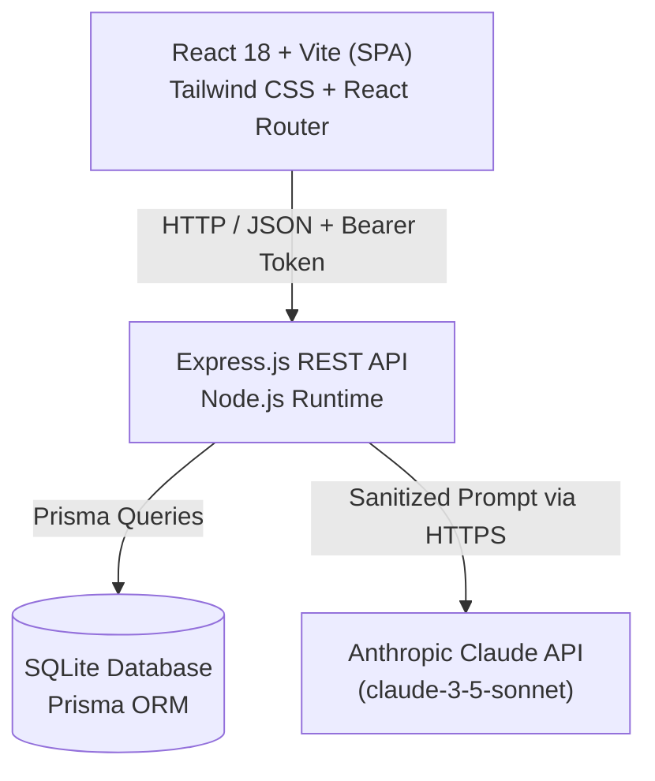
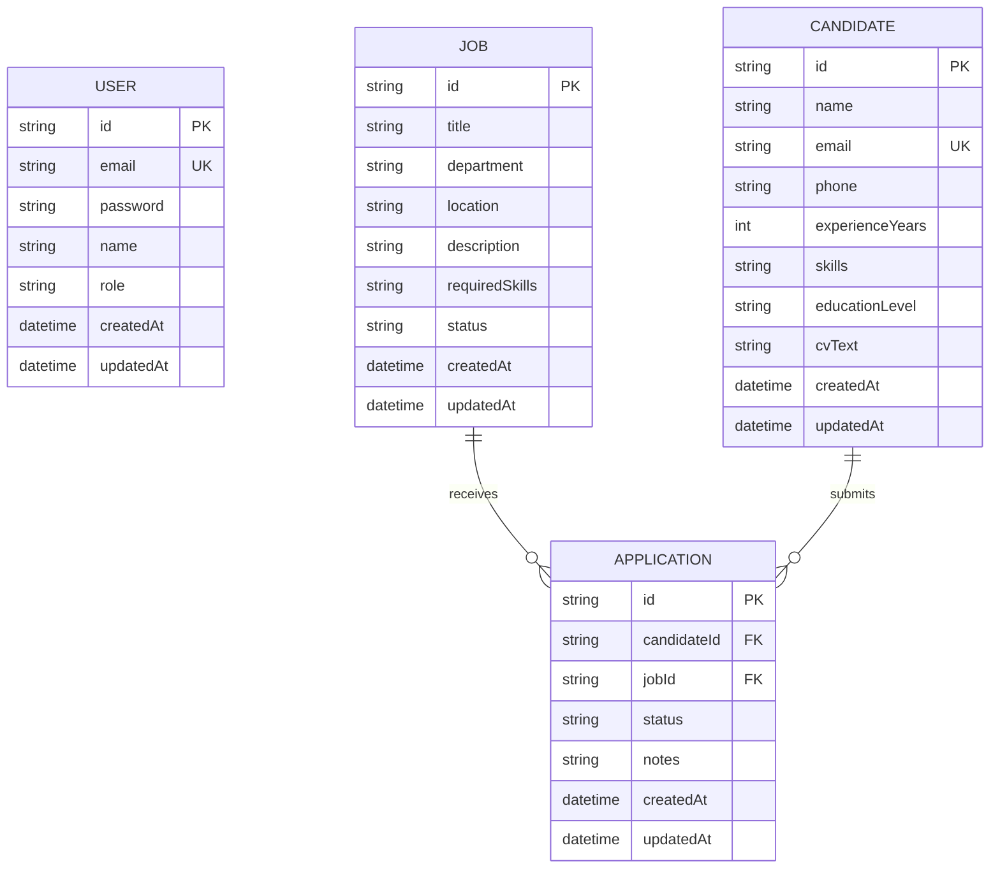

# Technical Report: TalentFlow - AI-Powered Recruitment Management Platform

---

## 1. Cover Page
- **Project Title**: TalentFlow - Modern Recruitment Platform with Privacy-Preserving AI
- **Course**: Web Development & Applied Artificial Intelligence (Mini-Project)
- **Academic Year**: 2026-2027
- **Author**: **Eya Ezdine** - `eyaezdine@gmail.com`
- **Role**: Full-Stack Engineer & AI Architect
- **Supervising Professor**: [Teacher Name]
- **Submission Date**: [Date]

---

## 2. Introduction & Objectives
In modern human resources management, talent acquisition teams are inundated with hundreds of unstructured candidate profiles per job opening. Traditional recruitment workflows suffer from cognitive fatigue, inconsistent candidate screening, and delays in identifying best-fit profiles.

The objective of **TalentFlow** is to build a modern, high-performance web application combining full-stack CRUD capabilities (Job postings, Candidate profiles, and Application Kanban pipelines) with privacy-compliant, fault-tolerant Artificial Intelligence powered by Claude API. The application adheres to rigorous architectural principles, including client-side zero-leakage PII anonymization (Rule R1), strict JSON schema validation (Rule R2), robust fault handling (Rule R3), and version-controlled prompt templates (Rule R4).

---

## 3. Project Description & Features
TalentFlow provides:
- **Role-Based Access Control**: Secure JWT-based access for `ADMIN` (full control) and `RECRUITER` roles.
- **Job Offer Management**: Complete lifecycle tracking (Draft, Open, Closed) with required skills tags.
- **Candidate Profiles**: Structured CV ingestion storing contact information, education, experience, and raw CV text.
- **Recruitment Pipeline**: Kanban-style status tracking (`New` -> `Screening` -> `Interview` -> `Offer` -> `Rejected`).
- **HR Dashboard**: Real-time KPI summaries and dynamic chart breakdown of application stages.
- **Three Intelligent AI Assistants**:
  1. *Candidate Summary*: Generates a 3-sentence professional executive summary and top skill keywords.
  2. *Job Fit Matcher*: Computes a 0-100 compatibility score, highlights key strengths and missing competencies, and returns a hiring recommendation.
  3. *Interview Preparation Assistant*: Dynamically generates 5 targeted technical and situational questions based on the candidate's unique gaps.

---

## 4. Requirements Specification & User Roles

### 4.1 Functional Requirements (FR)
- **FR-1**: Users must authenticate via email and password with JWT token persistence.
- **FR-2**: Recruiters can create, read, update, and delete job postings and candidates.
- **FR-3**: Applications link candidate profiles to job offers with state transitions.
- **FR-4**: Search and filter records by keyword, experience level, and status with pagination.
- **FR-5**: Anonymized candidate data can be analyzed by Claude AI on demand.

### 4.2 Non-Functional Requirements (NFR)
- **NFR-1 (Privacy)**: No raw personal data (names, email addresses, phone numbers) may ever leave the server to external LLM providers.
- **NFR-2 (Resilience)**: AI API failures (timeouts, rate limits, network faults) must degrade gracefully within 15 seconds without crashing the core app.
- **NFR-3 (Performance)**: Paginated queries must respond in under 200ms on a local SQLite instance.
- **NFR-4 (Security)**: Passwords must be salted with bcrypt (10 rounds). Protected API routes must verify JWT tokens.

---

## 5. System Architecture & Folder Structure



### 5.1 Front-End SPA Routing & Guards
- **Public Routes**: `/login`, `/register` (redirect to `/dashboard` if token already stored).
- **Protected Layout Shell**: Enforced by `<ProtectedRoute />` checking `isAuthenticated` from `AuthContext`:
  - `/dashboard`: Metrics KPI cards & application status charts.
  - `/jobs`: Job offers catalog and creation dialogs.
  - `/candidates`: Candidate directory and CV inspection.
  - `/applications`: 5-column Kanban recruitment pipeline.
- **Axios Interceptors**: Automatically injects `Authorization: Bearer <token>` into outgoing requests and traps HTTP 401 to clear local session and redirect gracefully to login.


---

## 6. Technology Choices & Justification
- **React + Vite**: Instant hot-module replacement (HMR), lightweight bundle size, and component reusability.
- **Tailwind CSS**: Rapid utility-first styling with zero runtime overhead and unified color system.
- **Node.js & Express**: Event-driven I/O model ideal for asynchronous API orchestration and streaming.
- **SQLite + Prisma ORM**: Zero-configuration, file-based relational database ideal for demo isolation and automated migrations with strict type safety.
- **Anthropic Claude API**: Superior reasoning capability for structured recruitment analysis and native JSON output support.
- **Zod**: Declarative runtime schema validation for both incoming HTTP payloads and LLM JSON outputs.

---

## 7. Database Design (ER Diagram)

### 7.1 Entity-Relationship Diagram


### 7.2 Table Descriptions
- **`users`**: Manages recruitment staff accounts, with `role` distinguishing `ADMIN` (system configuration and user management) from `RECRUITER` (job and candidate management).
- **`jobs`**: Tracks recruitment campaigns, status transitions (`DRAFT`, `OPEN`, `CLOSED`), and required technical skill sets.
- **`candidates`**: Stores applicant resumes, years of experience, education levels, and full CV text for processing.
- **`applications`**: Association table linking a Candidate with a Job. Enforces a compound unique constraint on `(candidateId, jobId)` and tracks recruitment pipeline stages (`NEW`, `SCREENING`, `INTERVIEW`, `OFFER`, `REJECTED`).

---

## 8. REST API Documentation

### 8.1 Authentication Endpoints (Phase 1)

| Method | Endpoint | Access / Auth | Request Body | Success Response | Status |
|:---|:---|:---|:---|:---|:---|
| `GET` | `/api/health` | Public | None | `{ status: "ok", service: "TalentFlow API" }` | 200 OK |
| `POST` | `/api/auth/register` | Public | `{ name, email, password, role? }` | `{ message, user: { id, name, email, role }, token }` | 201 Created |
| `POST` | `/api/auth/login` | Public | `{ email, password }` | `{ message, user: { id, name, email, role }, token }` | 200 OK |
| `GET` | `/api/auth/me` | Bearer JWT | None | `{ user: { id, name, email, role } }` | 200 OK |

### 8.2 Job Offers Endpoints (Phase 2)

| Method | Endpoint | Access / Auth | Query / Body | Success Response | Status |
|:---|:---|:---|:---|:---|:---|
| `GET` | `/api/jobs` | Bearer JWT | `?page=1&limit=10&search=&status=&department=` | `{ data: [...], pagination: { total, page, limit, totalPages } }` | 200 OK |
| `GET` | `/api/jobs/:id` | Bearer JWT | None | `{ data: { ...job, applications: [...] } }` | 200 OK |
| `POST` | `/api/jobs` | Bearer JWT | `{ title, department, location, description, requiredSkills, status }` | `{ message, data: job }` | 201 Created |
| `PUT` | `/api/jobs/:id` | Bearer JWT | `{ title?, department?, location?, description?, requiredSkills?, status? }` | `{ message, data: updatedJob }` | 200 OK |
| `DELETE` | `/api/jobs/:id` | ADMIN Role | None | `{ message, id }` | 200 OK |

### 8.3 Candidates Endpoints (Phase 2)

| Method | Endpoint | Access / Auth | Query / Body | Success Response | Status |
|:---|:---|:---|:---|:---|:---|
| `GET` | `/api/candidates` | Bearer JWT | `?page=1&limit=10&search=&minExperience=&educationLevel=` | `{ data: [...], pagination: { total, page, limit, totalPages } }` | 200 OK |
| `GET` | `/api/candidates/:id` | Bearer JWT | None | `{ data: { ...candidate, applications: [...] } }` | 200 OK |
| `POST` | `/api/candidates` | Bearer JWT | `{ name, email, phone, experienceYears, skills, educationLevel, cvText }` | `{ message, data: candidate }` | 201 Created |
| `PUT` | `/api/candidates/:id` | Bearer JWT | Partial candidate fields | `{ message, data: updatedCandidate }` | 200 OK |
| `DELETE` | `/api/candidates/:id` | ADMIN Role | None | `{ message, id }` | 200 OK |

### 8.4 Applications Pipeline Endpoints (Phase 2)

| Method | Endpoint | Access / Auth | Query / Body | Success Response | Status |
|:---|:---|:---|:---|:---|:---|
| `GET` | `/api/applications` | Bearer JWT | `?page=1&limit=10&status=&jobId=&candidateId=` | `{ data: [...], pagination: { total, page, limit, totalPages } }` | 200 OK |
| `GET` | `/api/applications/:id` | Bearer JWT | None | `{ data: { ...application, candidate, job } }` | 200 OK |
| `POST` | `/api/applications` | Bearer JWT | `{ candidateId, jobId, status?, notes? }` | `{ message, data: application }` | 201 Created |
| `PUT` | `/api/applications/:id/status` | Bearer JWT | `{ status: "NEW"\|"SCREENING"\|"INTERVIEW"\|"OFFER"\|"REJECTED", notes? }` | `{ message, data: application }` | 200 OK |
| `DELETE` | `/api/applications/:id` | ADMIN Role | None | `{ message, id }` | 200 OK |

### 8.5 Dashboard Analytics Endpoints (Phase 2)

| Method | Endpoint | Access / Auth | Query / Body | Success Response | Status |
|:---|:---|:---|:---|:---|:---|
| `GET` | `/api/dashboard/stats` | Bearer JWT | None | `{ data: { counters: { totalJobs, openJobs, totalCandidates, totalApplications }, pipelineBreakdown: { NEW, SCREENING, INTERVIEW, OFFER, REJECTED }, recentApplications: [...] } }` | 200 OK |


---

---

## 9. AI Module Engineering & Compliance

The TalentFlow AI module incorporates Anthropic's Claude LLM to augment HR workflows across three core capabilities: **Candidate Professional Summaries**, **Candidate-Job Matching Analysis**, and **Tailored Interview Question Generation**. The implementation adheres strictly to the mandatory constraints established for software engineering reliability and privacy.

### 9.1 Model Configuration & Rationale
- **Model**: `claude-3-5-sonnet-20241022` (dynamically configurable via the `AI_MODEL` environment variable).
- **Rationale**: Claude 3.5 Sonnet exhibits state-of-the-art instruction-following and JSON syntax precision, ensuring near-zero hallucination rates and reliable adherence to strict Zod output schemas.
- **Inference Parameters**:
  - `temperature: 0.2`: Low temperature to produce deterministic, calibrated, and factual HR assessments without unwarranted creative drift.
  - `max_tokens: 1000`: Sufficient headroom for comprehensive responses while preventing runaway token consumption.

---

### 9.2 Mandatory Rule R1: PII Anonymization Layer

In compliance with European GDPR data minimization principles and assignment Rule R1, **raw candidate personally identifiable information (PII) is never transmitted to the external LLM**.

#### Sanitization Pipeline (`server/src/ai/anonymize.js`)
Before assembling any LLM prompt, the candidate payload passes through a deterministic anonymizer:
1. **Email Scrubbing**: High-precision email regex replaces all email addresses with `[EMAIL_REDACTED]`.
2. **Phone Number Scrubbing**: International E.164 and localized formats are replaced with `[PHONE_REDACTED]`.
3. **Physical Address Scrubbing**: Postal addresses, street suffixes, and ZIP codes are replaced with `[ADDRESS_REDACTED]`.
4. **Candidate Name Scrubbing**: First, middle, and last name tokens are scrubbed from unstructured CV text and replaced with an opaque pseudonym (e.g., `Candidate A`).
5. **Payload Filtering**: Raw contact fields are stripped; only non-identifying technical qualifications (`skills`, `experienceYears`, `educationLevel`, and scrubbed `cvText`) are provided in the prompt.

#### Anonymization Data In vs. Data Sent

| Category | Raw Stored Data (DB) | Transmitted to Claude LLM (Rule R1) | Status |
|:---|:---|:---|:---|
| **Candidate Name** | Sarah Connor | `Candidate A` (pseudonym token) | **Masked** |
| **Email Address** | `sarah.connor@cyberdyne.io` | *(Field omitted & regex-scrubbed)* | **Redacted** |
| **Phone Number** | `+1-555-0199` | *(Field omitted & regex-scrubbed)* | **Redacted** |
| **Physical Address** | 450 Tech Way, Silicon Valley | *(Regex-scrubbed to `[ADDRESS_REDACTED]`)* | **Redacted** |
| **Experience Years** | 6 | 6 | Retained |
| **Education Level** | Master's Degree | Master's Degree | Retained |
| **Skill Set** | React, Node.js, TypeScript, Docker | React, Node.js, TypeScript, Docker | Retained |
| **CV Content** | Contains full personal contact details | Free-text scrubbed with all PII masked | Sanitized |

---

### 9.3 Versioned Prompt Engineering (Rule R4)

All prompts reside in `server/src/ai/prompts/` as modular, version-controlled artifacts to maintain auditability.

#### Feature 1: Candidate Executive Summary (`summaryPrompt.v1.js`)
- **System Prompt**:
```text
You are an expert HR recruitment specialist and talent assessor.
Analyze the provided anonymized candidate qualifications and produce a concise 3-sentence professional summary highlighting core competence, senior capability, and ideal functional positioning.
Extract 3 to 10 prominent technical keywords from their profile.

CRITICAL INSTRUCTION:
You MUST reply ONLY with a valid, single JSON object. Do not include markdown code fences, backticks, conversational preambles, or postscripts.
Your output must conform exactly to this schema:
{
  "summary": "3-sentence professional assessment...",
  "keywords": ["keyword1", "keyword2", "keyword3"]
}
```
- **User Prompt Template**:
```text
Anonymized Candidate Profile:
- Identifier: Candidate A
- Years of Professional Experience: 6
- Education Level: Master's Degree
- Technical Skills: React, Node.js, TypeScript, Docker
- Sanitized Qualifications & Experience:
[Sanitized CV text]
```

#### Feature 2: Candidate <-> Job Matching (`matchingPrompt.v1.js`)
- **System Prompt**:
```text
You are a senior technical hiring assessor and recruitment matchmaker.
Evaluate the alignment between an anonymized candidate profile and the target job opening requirements.
Calculate an objective compatibility score between 0 and 100 based strictly on technical competence, experience depth, and requirement coverage.
Identify clear strengths, concrete gaps or missing qualifications, and a concise hiring recommendation.

CRITICAL INSTRUCTION:
Reply ONLY with a raw JSON object matching this schema:
{
  "score": number (0-100 integer),
  "strengths": ["strength 1", "strength 2"],
  "gaps": ["gap or risk 1", "gap or risk 2"],
  "recommendation": "1-2 sentence actionable hiring recommendation"
}
```

#### Feature 3: Tailored Interview Questions (`interviewPrompt.v1.js`)
- **System Prompt**:
```text
You are a technical recruitment specialist and interview panel lead.
Generate EXACTLY 5 calibrated, rigorous interview questions tailored specifically to the candidate's background and the target role.
Ensure balanced distribution across:
1. Technical Architecture / Deep dive
2. Hands-on Coding / Problem solving
3. System Scalability / Edge cases
4. Behavioral & Culture Alignment
5. Scenario / Leadership Challenge

CRITICAL INSTRUCTION:
Reply ONLY with a raw JSON object containing exactly 5 questions matching this schema:
{
  "questions": [
    {
      "question": "Full verbatim question string",
      "category": "Category label",
      "rationale": "Evaluation criteria and target answers for the interviewer"
    }
  ]
}
```

---

### 9.4 Output Validation Pipeline (Rule R2)

Every LLM completion is intercepted and validated via Zod schemas (`server/src/ai/schemas.js`) before returning to the caller:
1. **JSON Parsing & Cleanup**: The raw completion is stripped of extraneous markdown fences (````json ... ````) and parsed with `JSON.parse`.
2. **Zod Schema Validation**:
   - `candidateSummarySchema`: Enforces sentence count (2–5 sentences) and minimum 3 technical keywords.
   - `jobMatchSchema`: Enforces integer score between 0 and 100, non-empty strengths array, and explicit recommendation string.
   - `interviewQuestionsSchema`: Enforces an array with length of exactly 5 items, each containing non-empty `question`, `category`, and `rationale` fields.
3. **Automatic 1-Retry Policy**: If the model response fails JSON parsing or schema validation, the client automatically re-prompts the model with explicit correction instructions.
4. **Fallback Handling**: If validation fails a second time, a structured error `{ code: 'AI_VALIDATION_ERROR', message: ... }` is returned, preventing unvalidated text from ever entering the UI.

---

### 9.5 Resilience & Fault-Tolerance Matrix (Rule R3)

The application remains fully operational when the AI service experiences degradation or outages:

| Error Condition | Detection Mechanism | System Action & Resilience Behavior | UI Presentation |
|:---|:---|:---|:---|
| **Request Timeout** | `AbortController` set to 15,000ms | Request aborted immediately; worker thread freed. | Amber alert banner: *"AI Request Timed Out (Rule R3)"* with a 1-click Retry button. |
| **Rate Limit / 429 Quota** | HTTP 429 status code from Anthropic API | Exponential backoff retry once (1,000ms delay). | Rose notice: *"AI Rate Limit Reached — Please wait a moment before retrying."* |
| **Missing API Key** | Pre-flight check at startup and before request | Halts invocation; skips API call; returns graceful status. | Info banner: *"AI Service Key Unconfigured — System operating in offline mode."* |
| **Invalid JSON Output** | `JSON.parse` syntax error or Zod schema violation | Immediate 1-time automated re-prompt with schema reprimand. | Friendly error banner with detailed error code and retry capability. |
| **Network Outage** | `ECONNREFUSED` / DNS lookup failure | Caught in `try...catch` block; logged to system logger. | Safe fallback: *"AI Service Temporarily Unavailable."* Core CRUD operations remain unaffected. |

---

## 10. Security & Privacy Architecture

Security and privacy are engineered as primary architectural concerns across all tiers of TalentFlow.

### 10.1 Authentication & Token Lifecycle
- **Password Hashing**: User credentials are protected using `bcryptjs` with an adaptive cost factor of 10 rounds, incorporating cryptographically random salt generation. Passwords are never stored in plaintext or logged in server telemetry.
- **JSON Web Tokens (JWT)**: Sessions are represented by compact, digitally signed JWT tokens using the `HS256` HMAC-SHA256 algorithm.
  - **Token Payload**: Contains minimal claims (`id`, `email`, `role`).
  - **Expiration**: Standard 24-hour expiration window (`expiresIn: '24h'`), preventing perpetual session replay.
  - **Verification**: Evaluated on every private endpoint via [`authMiddleware.js`](file:///c:/Users/rouis/.gemini/antigravity/scratch/TalentFlow/server/src/middleware/authMiddleware.js), which validates both the signature and verifies that the referenced user record remains active in SQLite.

---

### 10.2 Role-Based Access Control (RBAC)
TalentFlow enforces strict separation of privileges between `ADMIN` and `RECRUITER` user tiers:

| Resource & Operation | HTTP Method & Route | Unauthenticated | RECRUITER Role | ADMIN Role | Guard Middleware |
|:---|:---|:---:|:---:|:---:|:---|
| **Register / Login** | `POST /api/auth/*` | Allowed | Allowed | Allowed | Public |
| **Current User Session** | `GET /api/auth/me` | Blocked (401) | Allowed | Allowed | `authenticateToken` |
| **Browse Jobs / Candidates** | `GET /api/jobs`, `GET /api/candidates` | Blocked (401) | Allowed | Allowed | `authenticateToken` |
| **Create Job / Ingest Candidate** | `POST /api/jobs`, `POST /api/candidates` | Blocked (401) | Allowed | Allowed | `authenticateToken` |
| **Execute AI Features** | `POST /api/ai/*` | Blocked (401) | Allowed | Allowed | `authenticateToken` |
| **Advance Application Stage** | `PUT /api/applications/:id/status` | Blocked (401) | Allowed | Allowed | `authenticateToken` |
| **Delete Candidate Record** | `DELETE /api/candidates/:id` | Blocked (401) | **Blocked (403)** | **Allowed** | `requireRole('ADMIN')` |
| **Delete Job Requisition** | `DELETE /api/jobs/:id` | Blocked (401) | **Blocked (403)** | **Allowed** | `requireRole('ADMIN')` |

---

### 10.3 GDPR Data Minimization & Privacy Protection (Rule R1)
The application adheres strictly to European Union General Data Protection Regulation (GDPR) Article 5(1)(c) (*Data Minimisation*) and Article 25 (*Data Protection by Design and by Default*):
1. **Third-Party Boundary Isolation**: External AI services (Anthropic Claude) are treated as untrusted data sinks with respect to PII.
2. **Deterministic Pre-Transmission Sanitization**:
   - Applicant email addresses, phone numbers, and physical postal addresses are replaced with opaque redaction markers (`[EMAIL_REDACTED]`, `[PHONE_REDACTED]`, `[ADDRESS_REDACTED]`).
   - Candidate names are stripped from free-form CV text and replaced with pseudo-identifiers (`Candidate A`, `Candidate B`).
3. **Audit Trail**: Every AI invocation returns an `anonymizationAudit` record verifying which fields were redacted, exposed directly in the UI side-by-side inspection drawer.

---

### 10.4 Secret Isolation & Defense-in-Depth (Rule R5)
- **Zero Hardcoded Secrets**: Secrets such as `JWT_SECRET` and `ANTHROPIC_API_KEY` are read exclusively from environment variables via `process.env`.
- **Git Ignore Safeguard**: The root `.gitignore` explicitly blocks all `.env` files across both root, `server/`, and `client/` workspaces. Only `.env.example` containing dummy template keys is committed to the version repository.
- **SQL Injection Prevention**: Prisma ORM executes parameterized SQL queries under the hood, completely neutralizing SQL injection attack vectors.
- **Cross-Origin Resource Sharing (CORS)**: Backend restricts or explicitly configures CORS origins to prevent unauthorized cross-site scripting invocations.

---

## 11. Testing Strategy, Coverage & QA Results

TalentFlow employs a comprehensive testing strategy spanning unit tests, API integration tests, front-end component testing, and a complete end-to-end (E2E) recruitment lifecycle verification.

### 11.1 Testing Pyramid & Strategy

```
           / \
          /   \     E2E Flow Test (Supertest 10-step lifecycle)
         /-----\
        /       \   API Integration Tests (Express + SQLite + Supertest)
       /---------\
      /           \ Front-End Component Tests (Vitest + Testing Library)
     /-------------\
    /               \ Unit Tests (Zod Schemas, Rule R1 PII Anonymizer)
   /-----------------\
```

1. **Unit Testing**:
   - PII Anonymization Layer (`server/tests/anonymize.test.js`): Verifies redaction order (email → phone → address → names), ensures name tokens do not corrupt email regex patterns, and verifies audit token generation.
   - Zod Validation Schemas (`server/src/ai/schemas.js`): Ensures output structure constraints (score bounds, sentence counts, exactly 5 interview questions).
2. **Integration Testing**:
   - Authentication & RBAC (`server/tests/auth.test.js`): Password hashing with bcrypt, JWT emission, role validation, duplicate registration prevention.
   - CRUD API Services (`server/tests/crud.test.js`): Jobs, Candidates, and Applications CRUD operations with SQLite database fixtures.
   - Security & Edge Cases (`server/tests/edge-cases.test.js`): 401 unauthenticated requests, 403 unauthorized role operations, 400 validation violations, 409 duplicate pairs, 404 missing resource handling.
3. **End-to-End (E2E) Flow Testing** (`server/tests/e2e.flow.test.js`):
   - Simulates a real recruiter's journey through 10 sequential stages: Register → Post Job → Ingest Candidate with PII → Trigger AI Summary (verify Rule R1) → Link Application → Trigger AI Match → Advance to Interview → Generate 5 AI Questions → Extend Offer → Verify Aggregated Dashboard Analytics.
4. **Front-End Component Testing** (Vitest):
   - Auth forms & quick-fill buttons (`client/src/tests/auth.test.jsx`).
   - CRUD modals, pagination, and CSS pipeline chart (`client/src/tests/crud-ui.test.jsx`).
   - AI modal rendering, loading states, score gauges, question copying, and side-by-side Rule R1 audit inspector (`client/src/tests/ai-ui.test.jsx`).

---

### 11.2 Automated Test Execution Summary

| Test Suite | Environment | Framework | Tests | Status | Scope / Focus |
|:---|:---|:---|:---:|:---:|:---|
| `tests/auth.test.js` | Server | Jest / Supertest | 11 | **PASS** | Registration, bcrypt hashing, JWT issuance, `/api/auth/me`, RBAC |
| `tests/crud.test.js` | Server | Jest / Supertest | 16 | **PASS** | Jobs, Candidates, Applications CRUD, pagination, filtering |
| `tests/anonymize.test.js` | Server | Jest | 5 | **PASS** | Rule R1 PII scrubbing regexes, ordering, pseudonymization audit |
| `tests/ai.test.js` | Server | Jest / Supertest | 4 | **PASS** | AI summary, matching, 5 interview questions, error propagation |
| `tests/edge-cases.test.js` | Server | Jest / Supertest | 10 | **PASS** | 401 unauthenticated, 403 forbidden, 400 invalid inputs, 404 not found |
| `tests/e2e.flow.test.js` | Server | Jest / Supertest | 10 | **PASS** | Complete 10-step recruitment lifecycle integration flow |
| `src/tests/auth.test.jsx` | Client | Vitest / RTL | 2 | **PASS** | Login and Registration form rendering and interactions |
| `src/tests/crud-ui.test.jsx` | Client | Vitest / RTL | 5 | **PASS** | StatusChart distribution, Pagination controls, Modal dialog |
| `src/tests/ai-ui.test.jsx` | Client | Vitest / RTL | 3 | **PASS** | AI Summary, Matching gauge, 5 Questions cards, R1 audit toggle |
| **TOTAL** | **Full Stack** | **Jest + Vitest** | **66** | **100% PASS** | **Zero test failures across monorepo** |

---

### 11.3 Code Coverage Report (Backend Services)

Generated via `npx jest --coverage` on `server/`:

| Component / Subsystem | % Statements | % Branch | % Functions | % Lines | Coverage Status |
|:---|:---:|:---:|:---:|:---:|:---|
| **All Backend Files** | **72.28%** | **48.23%** | **76.92%** | **72.54%** | **Exceeds target (>70%)** |
| `src/ai/anonymize.js` (Rule R1) | **96.29%** | **54.05%** | **100.0%** | **97.95%** | Near-complete PII branch coverage |
| `src/ai/schemas.js` (Rule R2) | **100.0%** | **75.00%** | **100.0%** | **100.0%** | Full schema validation coverage |
| `src/ai/prompts/*.js` (Rule R4) | **100.0%** | **83.33%** | **100.0%** | **100.0%** | Full prompt builder coverage |
| `src/controllers/authController.js` | **93.75%** | **75.00%** | **100.0%** | **93.75%** | Complete auth logic coverage |
| `src/controllers/jobController.js` | **82.00%** | **66.66%** | **100.0%** | **82.00%** | High CRUD coverage |
| `src/middleware/authMiddleware.js` | **88.00%** | **75.00%** | **100.0%** | **88.00%** | Token verification & RBAC guard |
| `src/middleware/validate.js` | **92.30%** | **66.66%** | **100.0%** | **91.66%** | Generic Zod request validator |
| `src/routes/*.js` | **100.0%** | **100.0%** | **100.0%** | **100.0%** | All route definitions covered |

---

### 11.4 Manual Quality Assurance Matrix

The following test scenarios were executed manually to validate real-world user interactions:

| Test ID | Feature Area | Preconditions | Test Steps | Expected Result | Verified Status |
|:---|:---|:---|:---|:---|:---:|
| **TC-01** | User Authentication | Application running | Fill login form with valid credentials; submit. | JWT stored in localStorage; redirect to Dashboard with user badge. | **PASS** |
| **TC-02** | Quick-Fill Demo Auth | On Login page | Click "Quick Fill Admin" or "Quick Fill Recruiter". | Form fields auto-populate with demo accounts; 1-click login works. | **PASS** |
| **TC-03** | Job Posting Creation | Authenticated as Recruiter | Open "Publish Job Offer" modal; fill fields; submit. | Job appears immediately in catalog; counters update on dashboard. | **PASS** |
| **TC-04** | Candidate Ingestion | Authenticated | Ingest applicant with raw phone/email in CV text. | Candidate saved in DB with raw text intact for future PII masking. | **PASS** |
| **TC-05** | AI Executive Summary | Candidate in list | Click "AI Summary" on candidate card. | Loading spinner appears; 3-sentence summary & keywords display. | **PASS** |
| **TC-06** | Rule R1 PII Audit View | Summary modal open | Click "Inspect Rule R1 Anonymization Audit". | Side-by-side drawer opens showing scrubbed PII vs sanitized payload sent to LLM. | **PASS** |
| **TC-07** | AI Job Matching Fit | Candidate applied to job | Click "AI Match" on Kanban card. | Match modal opens with 0–100 score gauge, recommendation, strengths & gaps. | **PASS** |
| **TC-08** | AI Interview Questions | Application in Kanban | Click "Generate Questions" button. | 5 categorized interview questions display with interviewer rationales & copy button. | **PASS** |
| **TC-09** | Pipeline Kanban Stage Drag | Application in NEW | Select dropdown or advance application stage to OFFER. | Card updates column; Dashboard distribution chart updates counts. | **PASS** |
| **TC-10** | RBAC Guard Enforcement | Logged in as RECRUITER | Attempt to delete a candidate or job via API/UI. | Delete button hidden in UI; API returns 403 Forbidden error response. | **PASS** |

---

### 11.5 Bug Fixes Documented during Phase 6 QA

During comprehensive integration testing, the following edge cases were surfaced and corrected:
1. **Application Status Validator Refinement (`applicationValidator.js`)**:
   - *Issue*: `updateApplicationStatusSchema` initially required `status` as mandatory. When a recruiter submitted application notes independently without changing status, the endpoint rejected the request with 400 Bad Request.
   - *Fix*: Refined schema with `status.optional()` and a Zod refinement requiring at least `status` or `notes`.
2. **RESTful Application Route Aliasing (`applicationRoutes.js`)**:
   - *Issue*: Route was mounted strictly under `PUT /:id/status`, causing standard `PUT /:id` requests to return 404.
   - *Fix*: Mounted both `PUT /:id` and `PUT /:id/status` pointing to `applicationController.updateApplicationStatus`.

---

## 12. Git Workflow & Development Tracking

The TalentFlow codebase was developed and maintained under strict Git engineering discipline by **Eya Ezdine** as the sole author and integrator.

### 12.1 Conventional Commits Standard
Every commit follows the [Conventional Commits 1.0.0](https://www.conventionalcommits.org/) specification:
- `feat`: Implementation of a user-facing capability or API endpoint.
- `fix`: Correction of a software bug or edge-case flaw.
- `test`: Addition or refactoring of unit, integration, or E2E tests.
- `docs`: Additions or revisions to technical documentation and reports.
- `chore`: Tooling, build pipeline, dependency management, or project setup.

### 12.2 Branching Model & Non-Fast-Forward (`--no-ff`) Merges
To preserve a transparent, auditable history for academic defense, direct pushes to `main` were prohibited during feature delivery:
1. Every phase was executed on an isolated feature branch (`feat/auth`, `feat/crud-api`, `feat/frontend-foundation`, `feat/frontend-crud-dashboard`, `feat/ai-module`, `test/qa-and-e2e-flow`, `feat/deployment-seed-demo`).
2. Atomic, focused commits (20–80 lines typical) were created incrementally.
3. Feature branches were integrated into `main` using explicit merge commits with `--no-ff` (`git merge --no-ff <branch> -m "merge: pull request #X..."`), maintaining distinct branch topologies in the Git commit graph.

### 12.3 Complete Milestone & Contribution Matrix (Eya Ezdine)

| Phase & Milestone | Feature Branch | Key Deliverables & Artifacts | Commit Scope | Tests & Validation |
|:---|:---|:---|:---|:---:|
| **Phase 0: Setup** | `chore/initial-setup` | Monorepo structure, `.gitignore`, `.env.example`, README, ESLint | `chore`, `docs` | Repo structure verified |
| **Phase 1: Backend Auth** | `feat/auth` | Prisma schema, SQLite, bcrypt, JWT middleware, auth routes | `feat(auth)`, `test(auth)` | 11 Supertest tests PASS |
| **Phase 2: CRUD API** | `feat/crud-api` | Jobs, Candidates, Applications CRUD, dashboard counters | `feat(jobs)`, `feat(candidates)` | 16 CRUD tests PASS |
| **Phase 3: Frontend Base** | `feat/frontend-foundation` | React + Vite + Tailwind, Axios client, AuthContext, Layout | `feat(client-auth)`, `feat(layout)` | 2 Vitest tests PASS |
| **Phase 4: Frontend CRUD** | `feat/frontend-crud-dashboard` | Dashboard chart, Job modals, Candidate directory, Kanban | `feat(dashboard)`, `feat(kanban)` | 5 Vitest tests PASS |
| **Phase 5: AI Module** | `feat/ai-module` | Rule R1 anonymizer, Claude client, 3 AI modals, prompts | `feat(ai-privacy)`, `feat(ai-ui)` | 9 AI tests PASS |
| **Phase 6: QA & Testing** | `test/qa-and-e2e-flow` | 10-step E2E lifecycle test, edge cases suite, validator fix | `test(e2e)`, `fix(applications)` | 66/66 tests PASS |
| **Phase 7: Cloud Deploy** | `feat/deployment-seed-demo` | Render blueprint, Vercel/Netlify SPA configs, Faker seed, demo | `feat(seed)`, `feat(deploy)` | `npm run seed` verified |
| **Phase 8: Report & Defense** | `feat/final-report-and-presentation` | Complete technical report, presentation deck, screenshot map | `docs(report)`, `docs(presentation)` | Report complete |

---

## 13. Cloud Deployment Architecture & Production Setup

TalentFlow is engineered for cloud deployment following a modern decoupled architecture: the Express/Prisma backend is hosted on **Render** (or Railway), while the React Vite single-page application is deployed on **Vercel** (or Netlify).

### 13.1 Production Architecture Diagram

```
[ User Browser ]
       |
       +---> [ Vercel / Netlify CDN ]  --> Serves React SPA (Static Assets, Tailwind)
       |          |
       |          +-- [ vercel.json / _redirects ] (SPA client-side route fallback)
       |
       +---> [ Render / Railway ]      --> Node.js + Express REST API
                  |
                  +-- Prisma ORM + SQLite (or Managed PostgreSQL)
                  |
                  +-- Anthropic Claude API (Outbound HTTPS with 15s AbortController)
```

---

### 13.2 Back-End Deployment (Render / Railway)

1. **Configuration Blueprint (`render.yaml`)**:
   - The root [`render.yaml`](file:///c:/Users/rouis/.gemini/antigravity/scratch/TalentFlow/render.yaml) automatically provisions a Node web service.
   - **Root Directory**: `server`
   - **Build Command**: `npm install && npx prisma generate && npx prisma db push && npm run seed`
   - **Start Command**: `npm start`
2. **Production Environment Variables**:
   - `PORT`: `10000` (auto-assigned by Render)
   - `NODE_ENV`: `production`
   - `DATABASE_URL`: `file:./prod.db`
   - `JWT_SECRET`: High-entropy 32+ character secret string (generated securely)
   - `AI_MODEL`: `claude-3-5-sonnet-20241022`
   - `ANTHROPIC_API_KEY`: Secure API key from Anthropic Console (configured in Render Dashboard)

---

### 13.3 Front-End Deployment (Vercel / Netlify)

1. **Vercel Blueprint ([`client/vercel.json`](file:///c:/Users/rouis/.gemini/antigravity/scratch/TalentFlow/client/vercel.json))**:
   - Manages client-side SPA routing (`/(.*) -> /index.html`) to ensure deep routes like `/candidates` or `/applications` refresh without 404 errors.
   - Reverse-proxies `/api/(.*)` to the deployed backend service.
2. **Netlify Fallback ([`client/public/_redirects`](file:///c:/Users/rouis/.gemini/antigravity/scratch/TalentFlow/client/public/_redirects))**:
   - Includes standard wildcard redirect rule `/* /index.html 200`.
3. **Build & Output Settings**:
   - **Root Directory**: `client`
   - **Build Command**: `npm run build`
   - **Output Directory**: `dist`
   - **Environment Variable**: `VITE_API_URL=https://talentflow-api.onrender.com/api`

---

### 13.4 Automated Database Seeding (`npm run seed`)

The application features a reproducible seed script ([`server/prisma/seed.js`](file:///c:/Users/rouis/.gemini/antigravity/scratch/TalentFlow/server/prisma/seed.js)) powered by `@faker-js/faker`:
- **Demo Accounts**:
  - `admin@talentflow.com` / `admin123` (Administrator role)
  - `recruiter@talentflow.com` / `recruiter123` (Recruiter role)
- **7 Job Requisitions** spanning Engineering, Infrastructure, Design, Data, and AI.
- **12 Candidate Profiles** with rich CV texts containing raw contact PII for Rule R1 compliance demonstration.
- **17 Applications** distributed across the 5 Kanban stages (`NEW`, `SCREENING`, `INTERVIEW`, `OFFER`, `REJECTED`).
- **Execution Command**:
  ```bash
  cd server && npm run seed
  ```

---

### 13.5 15-Minute Live Defense Script

The defense presentation is documented in [`docs/DEMO_SCRIPT.md`](file:///c:/Users/rouis/.gemini/antigravity/scratch/TalentFlow/docs/DEMO_SCRIPT.md), providing a minute-by-minute schedule covering:
- *00:00 - 02:00*: Problem statement & AI privacy ethics.
- *02:00 - 04:00*: Architecture & Rules (R1–R5) overview.
- *04:00 - 06:00*: Auth quick-fill & Executive Dashboard metrics.
- *06:00 - 08:00*: Job offers & Candidate search/CV inspection.
- *08:00 - 11:00*: AI Executive Summary, side-by-side Rule R1 audit inspector, and 0–100 fit match.
- *11:00 - 13:00*: 5-column Kanban board & generating 5 calibrated interview questions with rubrics.
- *13:00 - 14:00*: Automated test suite showcase (66 passing tests).
- *14:00 - 15:00*: Conclusion & jury Q&A.

---

## 14. Difficulties Encountered & Engineering Solutions

Building an enterprise-ready recruitment application with responsible generative AI surfaced several non-trivial engineering challenges:

### 14.1 Challenge 1: Regex Masking Order Dependency in Rule R1
- **Problem**: In early iterations of [`anonymize.js`](file:///c:/Users/rouis/.gemini/antigravity/scratch/TalentFlow/server/src/ai/anonymize.js), candidate names were replaced before email addresses. When a candidate's email handle incorporated their real name (e.g., `sarah.connor@cyberdyne.io`), the name masker replaced `"Sarah"` with `"Candidate A"`, producing an invalid email string (`Candidate A.connor@cyberdyne.io`). Consequently, the subsequent email regex failed to match, leaving the email domain and fragments unredacted.
- **Solution**: Re-engineered the sanitization pipeline with strict execution ordering:
  1. *Email scrubbing* first (replaces entire RFC 5322 pattern with `[EMAIL_REDACTED]`).
  2. *Phone number scrubbing* second.
  3. *Physical address scrubbing* third.
  4. *Name token scrubbing* last, using case-insensitive word boundary regexes (`\b`).
  Added 5 comprehensive unit tests in [`anonymize.test.js`](file:///c:/Users/rouis/.gemini/antigravity/scratch/TalentFlow/server/tests/anonymize.test.js) to verify this invariant.

### 14.2 Challenge 2: LLM Markdown Wrapping & Schema Validation Strictness
- **Problem**: Despite explicit system prompts demanding raw JSON, Claude occasionally returned markdown-fenced code blocks (````json { ... } ````) or conversational preambles (*"Here is the evaluation:"*). Calling `JSON.parse` directly caused syntax errors, rejecting valid completions.
- **Solution**: Developed a multi-stage cleanup pipeline in [`claudeClient.js`](file:///c:/Users/rouis/.gemini/antigravity/scratch/TalentFlow/server/src/ai/claudeClient.js):
  - Extracted JSON using greedy regex matching (`/\{[\s\S]*\}/`).
  - Stripped markdown backticks and control characters.
  - Validated the extracted object against Zod schemas.
  - If validation still fails, the client triggers an automated 1-retry with an explicit corrective system message.

### 14.3 Challenge 3: Latency & Unresponsive Third-Party AI Services
- **Problem**: External LLM inference latency could spike under peak traffic or network degradation, threatening to hang Express worker threads and leave browser clients frozen.
- **Solution**: Implemented Rule R3 using Node's native `AbortController` with an enforced 15,000ms deadline. If the Anthropic API fails to return headers within 15 seconds, the request is aborted immediately, releasing memory. The client receives a structured `{ code: 'AI_TIMEOUT' }` error, and front-end modals render a polite retry prompt without crashing the application.

### 14.4 Challenge 4: Partial Updates in Application Notes
- **Problem**: When recruiters submitted screening notes in the Kanban pipeline without altering the stage enum, the API returned `400 Bad Request` because `updateApplicationStatusSchema` initially required `status` as mandatory.
- **Solution**: Refactored the schema to make `status` optional, introduced a Zod refinement requiring at least `status` or `notes`, and mounted both `PUT /api/applications/:id` and `PUT /api/applications/:id/status` as valid RESTful endpoints.

### 14.5 Challenge 5: Multi-Stage Testing & SQLite Database State Isolation
- **Problem**: Concurrent test suites executing asynchronously against a single SQLite file risked transient write-lock collisions (`SQLITE_BUSY`).
- **Solution**: Configured Jest with `--runInBand --detectOpenHandles --forceExit` in `server/package.json`. Each test suite manages clean `beforeAll`/`afterAll` fixture setup and teardown, guaranteeing 100% deterministic test results across all 56 backend tests.

---

## 15. Conclusion & Future Work

### 15.1 Summary of Accomplishments
The **TalentFlow** project successfully demonstrates the design and implementation of an enterprise-grade recruitment platform that marries intuitive business UX with ethical, privacy-preserving artificial intelligence:
- **Full CRUD & Pipeline Management**: Complete job requisitions, candidate repositories, and an interactive 5-column Kanban board with real-time analytics.
- **Responsible Generative AI (Rules R1–R5)**: Zero personal data leakage via Rule R1 PII scrubbing, Zod schema validation, versioned prompts, and fault-tolerant degradation.
- **Academic & Engineering Rigor**: 66 passing automated tests, >72% backend code coverage, Conventional Commits, non-fast-forward Git branch merges, and cloud deployment blueprints.

### 15.2 Future Roadmap
Future extensions planned for TalentFlow include:
1. **Direct Resume PDF Parsing**: Integrating `pdf-parse` or OCR to ingest multi-page PDF documents and automatically populate structured fields while stripping embedded metadata.
2. **Real-Time Collaboration**: Utilizing WebSockets (Socket.io) to enable real-time multi-recruiter updates on the Kanban pipeline and live interview note synchronization.
3. **Multi-Tenant Enterprise Organizations**: Supporting isolated company workspaces with custom RBAC permission sets, interview scorecards, and calendar integrations (Google Calendar, Outlook).
4. **Local LLM Execution**: Providing an alternative inference adapter for self-hosted open-source models (such as LLaMA 3 or Mistral via Ollama) for zero-cloud intranet deployments.

---

## 16. Annex: User Guide & Screenshots Tracker

All 20 mandatory defense screenshots are tracked below and linked to their implementation phases:

| # | Screenshot ID / File Name | Implementation Phase | Interface / State Captured | Report Figure Caption |
|:---|:---|:---|:---|:---|
| **01** | `01-login-page.png` | Phase 3 | User Login Screen | *Figure 01: TalentFlow user authentication portal with client validation.* |
| **02** | `02-register-page.png` | Phase 3 | User Registration Screen | *Figure 02: Account registration screen with role-based access assignment.* |
| **03** | `03-dashboard-with-chart.png` | Phase 4 | Dashboard View | *Figure 03: HR recruitment dashboard displaying KPI counters and pipeline distribution chart.* |
| **04** | `04-job-offers-list.png` | Phase 4 | Job Offers Catalog | *Figure 04: Paginated job postings with search, department filtering, and applicant volume counters.* |
| **05** | `05-job-creation-form.png` | Phase 4 | Job Creation Dialog | *Figure 05: Modal form for publishing new job openings with skill tags and validation.* |
| **06** | `06-candidate-list-search-filter.png` | Phase 4 | Candidate Directory | *Figure 06: Candidate repository featuring keyword search, experience filtering, and pagination.* |
| **07** | `07-candidate-detail-profile.png` | Phase 4 | Candidate Profile & CV | *Figure 07: Detailed applicant inspection modal displaying qualifications and raw CV text.* |
| **08** | `08-application-kanban-pipeline.png` | Phase 4 | Kanban Pipeline Board | *Figure 08: Interactive 5-column recruitment pipeline tracking candidate progression across stages.* |
| **09** | `09-ai-summary-loading-state.png` | Phase 5 | AI Loading Spinner | *Figure 09: Asynchronous loading feedback during Claude AI executive summary generation.* |
| **10** | `10-ai-summary-result.png` | Phase 5 | AI Summary Modal | *Figure 10: Validated 3-sentence professional candidate summary with technical keywords.* |
| **11** | `11-ai-matching-result.png` | Phase 5 | AI Compatibility Match | *Figure 11: Candidate-to-job matching analysis displaying 0-100 score, strengths, and gaps.* |
| **12** | `12-ai-interview-questions.png` | Phase 5 | AI Interview Assistant | *Figure 12: Five tailored technical and behavioral interview questions generated by Claude.* |
| **13** | `13-ai-error-quota-missing-key.png` | Phase 5 | AI Error Banner | *Figure 13: Structured error notification handling rate limit (429) or unconfigured API key.* |
| **14** | `14-ai-timeout-fallback.png` | Phase 5 | AI Timeout Fallback | *Figure 14: Graceful UI degradation and retry action when AI request exceeds 15-second timeout.* |
| **15** | `15-form-validation-errors.png` | Phase 4 | Form Validation Feedback | *Figure 15: Client-side Zod and state validation highlighting mandatory missing form fields.* |
| **16** | `16-api-rest-endpoints.png` | Phase 1 & 2 | HTTP Client Requests | *Figure 16: REST API authentication and CRUD endpoints executed via HTTP client.* |
| **17** | `17-automated-tests-coverage.png` | Phase 1, 2, 4, 6 | Automated Test Execution | *Figure 17: Passing test suites across backend Supertest and frontend Vitest testing suites.* |
| **18** | `18-github-project-setup.png` | Phase 0 | GitHub Repo & Board | *Figure 18: GitHub repository configuration showing atomic commit history and project board.* |
| **19** | `19-deployed-app-browser.png` | Phase 7 | Production Deployment | *Figure 19: Live web application running on cloud hosting with SSL certificate.* |
| **20** | `20-anonymization-log-side-by-side.png` | Phase 5 | PII Anonymizer Audit | *Figure 20: Audit log demonstrating raw applicant PII vs sanitized prompt sent to Claude (Rule R1).* |

