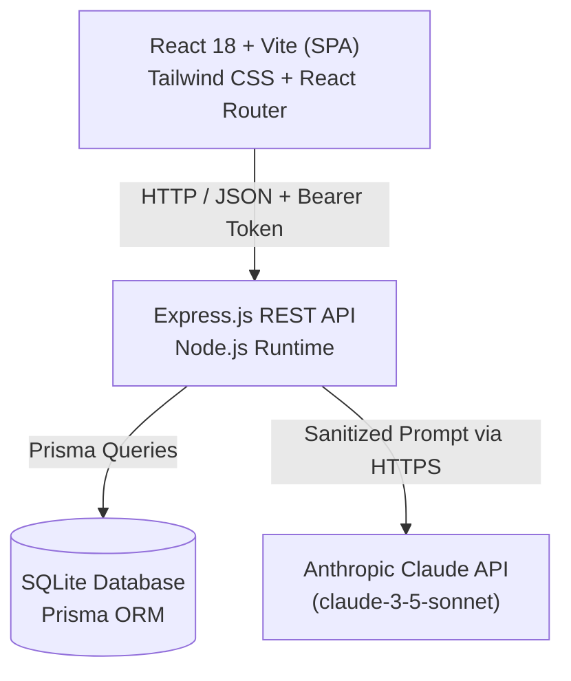
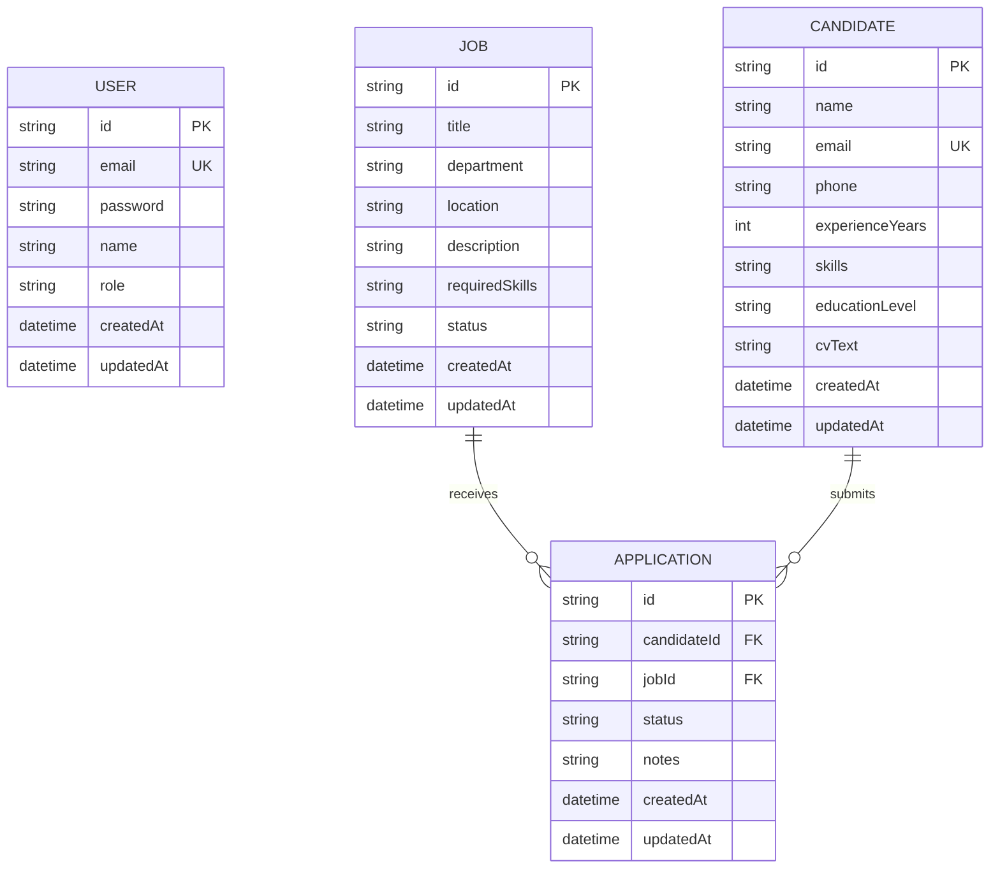

# Technical Report: TalentFlow - AI-Powered Recruitment Management Platform

---

## 1. Cover Page
- **Project Title**: TalentFlow - Modern Recruitment Platform with Privacy-Preserving AI
- **Course**: Web Development & Applied Artificial Intelligence (Mini-Project)
- **Academic Year**: 2026-2027
- **Author**: **Eya Ezdine** - `eyaezdine@gmail.com`
- **Role**: Full-Stack Engineer & AI Architect
- **Supervising Professor**: [Teacher Name]
- **Submission Date**: [Date]

---

## 2. Introduction & Objectives
In modern human resources management, talent acquisition teams are inundated with hundreds of unstructured candidate profiles per job opening. Traditional recruitment workflows suffer from cognitive fatigue, inconsistent candidate screening, and delays in identifying best-fit profiles.

The objective of **TalentFlow** is to build a modern, high-performance web application combining full-stack CRUD capabilities (Job postings, Candidate profiles, and Application Kanban pipelines) with privacy-compliant, fault-tolerant Artificial Intelligence powered by Claude API. The application adheres to rigorous architectural principles, including client-side zero-leakage PII anonymization (Rule R1), strict JSON schema validation (Rule R2), robust fault handling (Rule R3), and version-controlled prompt templates (Rule R4).

---

## 3. Project Description & Features
TalentFlow provides:
- **Role-Based Access Control**: Secure JWT-based access for `ADMIN` (full control) and `RECRUITER` roles.
- **Job Offer Management**: Complete lifecycle tracking (Draft, Open, Closed) with required skills tags.
- **Candidate Profiles**: Structured CV ingestion storing contact information, education, experience, and raw CV text.
- **Recruitment Pipeline**: Kanban-style status tracking (`New` -> `Screening` -> `Interview` -> `Offer` -> `Rejected`).
- **HR Dashboard**: Real-time KPI summaries and dynamic chart breakdown of application stages.
- **Three Intelligent AI Assistants**:
  1. *Candidate Summary*: Generates a 3-sentence professional executive summary and top skill keywords.
  2. *Job Fit Matcher*: Computes a 0-100 compatibility score, highlights key strengths and missing competencies, and returns a hiring recommendation.
  3. *Interview Preparation Assistant*: Dynamically generates 5 targeted technical and situational questions based on the candidate's unique gaps.

---

## 4. Requirements Specification & User Roles

### 4.1 Functional Requirements (FR)
- **FR-1**: Users must authenticate via email and password with JWT token persistence.
- **FR-2**: Recruiters can create, read, update, and delete job postings and candidates.
- **FR-3**: Applications link candidate profiles to job offers with state transitions.
- **FR-4**: Search and filter records by keyword, experience level, and status with pagination.
- **FR-5**: Anonymized candidate data can be analyzed by Claude AI on demand.

### 4.2 Non-Functional Requirements (NFR)
- **NFR-1 (Privacy)**: No raw personal data (names, email addresses, phone numbers) may ever leave the server to external LLM providers.
- **NFR-2 (Resilience)**: AI API failures (timeouts, rate limits, network faults) must degrade gracefully within 15 seconds without crashing the core app.
- **NFR-3 (Performance)**: Paginated queries must respond in under 200ms on a local SQLite instance.
- **NFR-4 (Security)**: Passwords must be salted with bcrypt (10 rounds). Protected API routes must verify JWT tokens.

---

## 5. System Architecture & Folder Structure



### 5.1 Front-End SPA Routing & Guards
- **Public Routes**: `/login`, `/register` (redirect to `/dashboard` if token already stored).
- **Protected Layout Shell**: Enforced by `<ProtectedRoute />` checking `isAuthenticated` from `AuthContext`:
  - `/dashboard`: Metrics KPI cards & application status charts.
  - `/jobs`: Job offers catalog and creation dialogs.
  - `/candidates`: Candidate directory and CV inspection.
  - `/applications`: 5-column Kanban recruitment pipeline.
- **Axios Interceptors**: Automatically injects `Authorization: Bearer <token>` into outgoing requests and traps HTTP 401 to clear local session and redirect gracefully to login.


---

## 6. Technology Choices & Justification
- **React + Vite**: Instant hot-module replacement (HMR), lightweight bundle size, and component reusability.
- **Tailwind CSS**: Rapid utility-first styling with zero runtime overhead and unified color system.
- **Node.js & Express**: Event-driven I/O model ideal for asynchronous API orchestration and streaming.
- **SQLite + Prisma ORM**: Zero-configuration, file-based relational database ideal for demo isolation and automated migrations with strict type safety.
- **Anthropic Claude API**: Superior reasoning capability for structured recruitment analysis and native JSON output support.
- **Zod**: Declarative runtime schema validation for both incoming HTTP payloads and LLM JSON outputs.

---

## 7. Database Design (ER Diagram)

### 7.1 Entity-Relationship Diagram


### 7.2 Table Descriptions
- **`users`**: Manages recruitment staff accounts, with `role` distinguishing `ADMIN` (system configuration and user management) from `RECRUITER` (job and candidate management).
- **`jobs`**: Tracks recruitment campaigns, status transitions (`DRAFT`, `OPEN`, `CLOSED`), and required technical skill sets.
- **`candidates`**: Stores applicant resumes, years of experience, education levels, and full CV text for processing.
- **`applications`**: Association table linking a Candidate with a Job. Enforces a compound unique constraint on `(candidateId, jobId)` and tracks recruitment pipeline stages (`NEW`, `SCREENING`, `INTERVIEW`, `OFFER`, `REJECTED`).

---

## 8. REST API Documentation

### 8.1 Authentication Endpoints (Phase 1)

| Method | Endpoint | Access / Auth | Request Body | Success Response | Status |
|:---|:---|:---|:---|:---|:---|
| `GET` | `/api/health` | Public | None | `{ status: "ok", service: "TalentFlow API" }` | 200 OK |
| `POST` | `/api/auth/register` | Public | `{ name, email, password, role? }` | `{ message, user: { id, name, email, role }, token }` | 201 Created |
| `POST` | `/api/auth/login` | Public | `{ email, password }` | `{ message, user: { id, name, email, role }, token }` | 200 OK |
| `GET` | `/api/auth/me` | Bearer JWT | None | `{ user: { id, name, email, role } }` | 200 OK |

### 8.2 Job Offers Endpoints (Phase 2)

| Method | Endpoint | Access / Auth | Query / Body | Success Response | Status |
|:---|:---|:---|:---|:---|:---|
| `GET` | `/api/jobs` | Bearer JWT | `?page=1&limit=10&search=&status=&department=` | `{ data: [...], pagination: { total, page, limit, totalPages } }` | 200 OK |
| `GET` | `/api/jobs/:id` | Bearer JWT | None | `{ data: { ...job, applications: [...] } }` | 200 OK |
| `POST` | `/api/jobs` | Bearer JWT | `{ title, department, location, description, requiredSkills, status }` | `{ message, data: job }` | 201 Created |
| `PUT` | `/api/jobs/:id` | Bearer JWT | `{ title?, department?, location?, description?, requiredSkills?, status? }` | `{ message, data: updatedJob }` | 200 OK |
| `DELETE` | `/api/jobs/:id` | ADMIN Role | None | `{ message, id }` | 200 OK |

### 8.3 Candidates Endpoints (Phase 2)

| Method | Endpoint | Access / Auth | Query / Body | Success Response | Status |
|:---|:---|:---|:---|:---|:---|
| `GET` | `/api/candidates` | Bearer JWT | `?page=1&limit=10&search=&minExperience=&educationLevel=` | `{ data: [...], pagination: { total, page, limit, totalPages } }` | 200 OK |
| `GET` | `/api/candidates/:id` | Bearer JWT | None | `{ data: { ...candidate, applications: [...] } }` | 200 OK |
| `POST` | `/api/candidates` | Bearer JWT | `{ name, email, phone, experienceYears, skills, educationLevel, cvText }` | `{ message, data: candidate }` | 201 Created |
| `PUT` | `/api/candidates/:id` | Bearer JWT | Partial candidate fields | `{ message, data: updatedCandidate }` | 200 OK |
| `DELETE` | `/api/candidates/:id` | ADMIN Role | None | `{ message, id }` | 200 OK |

### 8.4 Applications Pipeline Endpoints (Phase 2)

| Method | Endpoint | Access / Auth | Query / Body | Success Response | Status |
|:---|:---|:---|:---|:---|:---|
| `GET` | `/api/applications` | Bearer JWT | `?page=1&limit=10&status=&jobId=&candidateId=` | `{ data: [...], pagination: { total, page, limit, totalPages } }` | 200 OK |
| `GET` | `/api/applications/:id` | Bearer JWT | None | `{ data: { ...application, candidate, job } }` | 200 OK |
| `POST` | `/api/applications` | Bearer JWT | `{ candidateId, jobId, status?, notes? }` | `{ message, data: application }` | 201 Created |
| `PUT` | `/api/applications/:id/status` | Bearer JWT | `{ status: "NEW"\|"SCREENING"\|"INTERVIEW"\|"OFFER"\|"REJECTED", notes? }` | `{ message, data: application }` | 200 OK |
| `DELETE` | `/api/applications/:id` | ADMIN Role | None | `{ message, id }` | 200 OK |

### 8.5 Dashboard Analytics Endpoints (Phase 2)

| Method | Endpoint | Access / Auth | Query / Body | Success Response | Status |
|:---|:---|:---|:---|:---|:---|
| `GET` | `/api/dashboard/stats` | Bearer JWT | None | `{ data: { counters: { totalJobs, openJobs, totalCandidates, totalApplications }, pipelineBreakdown: { NEW, SCREENING, INTERVIEW, OFFER, REJECTED }, recentApplications: [...] } }` | 200 OK |


---

---

## 9. AI Module Engineering & Compliance

The TalentFlow AI module incorporates Anthropic's Claude LLM to augment HR workflows across three core capabilities: **Candidate Professional Summaries**, **Candidate-Job Matching Analysis**, and **Tailored Interview Question Generation**. The implementation adheres strictly to the mandatory constraints established for software engineering reliability and privacy.

### 9.1 Model Configuration & Rationale
- **Model**: `claude-3-5-sonnet-20241022` (dynamically configurable via the `AI_MODEL` environment variable).
- **Rationale**: Claude 3.5 Sonnet exhibits state-of-the-art instruction-following and JSON syntax precision, ensuring near-zero hallucination rates and reliable adherence to strict Zod output schemas.
- **Inference Parameters**:
  - `temperature: 0.2`: Low temperature to produce deterministic, calibrated, and factual HR assessments without unwarranted creative drift.
  - `max_tokens: 1000`: Sufficient headroom for comprehensive responses while preventing runaway token consumption.

---

### 9.2 Mandatory Rule R1: PII Anonymization Layer

In compliance with European GDPR data minimization principles and assignment Rule R1, **raw candidate personally identifiable information (PII) is never transmitted to the external LLM**.

#### Sanitization Pipeline (`server/src/ai/anonymize.js`)
Before assembling any LLM prompt, the candidate payload passes through a deterministic anonymizer:
1. **Email Scrubbing**: High-precision email regex replaces all email addresses with `[EMAIL_REDACTED]`.
2. **Phone Number Scrubbing**: International E.164 and localized formats are replaced with `[PHONE_REDACTED]`.
3. **Physical Address Scrubbing**: Postal addresses, street suffixes, and ZIP codes are replaced with `[ADDRESS_REDACTED]`.
4. **Candidate Name Scrubbing**: First, middle, and last name tokens are scrubbed from unstructured CV text and replaced with an opaque pseudonym (e.g., `Candidate A`).
5. **Payload Filtering**: Raw contact fields are stripped; only non-identifying technical qualifications (`skills`, `experienceYears`, `educationLevel`, and scrubbed `cvText`) are provided in the prompt.

#### Anonymization Data In vs. Data Sent

| Category | Raw Stored Data (DB) | Transmitted to Claude LLM (Rule R1) | Status |
|:---|:---|:---|:---|
| **Candidate Name** | Sarah Connor | `Candidate A` (pseudonym token) | **Masked** |
| **Email Address** | `sarah.connor@cyberdyne.io` | *(Field omitted & regex-scrubbed)* | **Redacted** |
| **Phone Number** | `+1-555-0199` | *(Field omitted & regex-scrubbed)* | **Redacted** |
| **Physical Address** | 450 Tech Way, Silicon Valley | *(Regex-scrubbed to `[ADDRESS_REDACTED]`)* | **Redacted** |
| **Experience Years** | 6 | 6 | Retained |
| **Education Level** | Master's Degree | Master's Degree | Retained |
| **Skill Set** | React, Node.js, TypeScript, Docker | React, Node.js, TypeScript, Docker | Retained |
| **CV Content** | Contains full personal contact details | Free-text scrubbed with all PII masked | Sanitized |

---

### 9.3 Versioned Prompt Engineering (Rule R4)

All prompts reside in `server/src/ai/prompts/` as modular, version-controlled artifacts to maintain auditability.

#### Feature 1: Candidate Executive Summary (`summaryPrompt.v1.js`)
- **System Prompt**:
```text
You are an expert HR recruitment specialist and talent assessor.
Analyze the provided anonymized candidate qualifications and produce a concise 3-sentence professional summary highlighting core competence, senior capability, and ideal functional positioning.
Extract 3 to 10 prominent technical keywords from their profile.

CRITICAL INSTRUCTION:
You MUST reply ONLY with a valid, single JSON object. Do not include markdown code fences, backticks, conversational preambles, or postscripts.
Your output must conform exactly to this schema:
{
  "summary": "3-sentence professional assessment...",
  "keywords": ["keyword1", "keyword2", "keyword3"]
}
```
- **User Prompt Template**:
```text
Anonymized Candidate Profile:
- Identifier: Candidate A
- Years of Professional Experience: 6
- Education Level: Master's Degree
- Technical Skills: React, Node.js, TypeScript, Docker
- Sanitized Qualifications & Experience:
[Sanitized CV text]
```

#### Feature 2: Candidate <-> Job Matching (`matchingPrompt.v1.js`)
- **System Prompt**:
```text
You are a senior technical hiring assessor and recruitment matchmaker.
Evaluate the alignment between an anonymized candidate profile and the target job opening requirements.
Calculate an objective compatibility score between 0 and 100 based strictly on technical competence, experience depth, and requirement coverage.
Identify clear strengths, concrete gaps or missing qualifications, and a concise hiring recommendation.

CRITICAL INSTRUCTION:
Reply ONLY with a raw JSON object matching this schema:
{
  "score": number (0-100 integer),
  "strengths": ["strength 1", "strength 2"],
  "gaps": ["gap or risk 1", "gap or risk 2"],
  "recommendation": "1-2 sentence actionable hiring recommendation"
}
```

#### Feature 3: Tailored Interview Questions (`interviewPrompt.v1.js`)
- **System Prompt**:
```text
You are a technical recruitment specialist and interview panel lead.
Generate EXACTLY 5 calibrated, rigorous interview questions tailored specifically to the candidate's background and the target role.
Ensure balanced distribution across:
1. Technical Architecture / Deep dive
2. Hands-on Coding / Problem solving
3. System Scalability / Edge cases
4. Behavioral & Culture Alignment
5. Scenario / Leadership Challenge

CRITICAL INSTRUCTION:
Reply ONLY with a raw JSON object containing exactly 5 questions matching this schema:
{
  "questions": [
    {
      "question": "Full verbatim question string",
      "category": "Category label",
      "rationale": "Evaluation criteria and target answers for the interviewer"
    }
  ]
}
```

---

### 9.4 Output Validation Pipeline (Rule R2)

Every LLM completion is intercepted and validated via Zod schemas (`server/src/ai/schemas.js`) before returning to the caller:
1. **JSON Parsing & Cleanup**: The raw completion is stripped of extraneous markdown fences (````json ... ````) and parsed with `JSON.parse`.
2. **Zod Schema Validation**:
   - `candidateSummarySchema`: Enforces sentence count (2–5 sentences) and minimum 3 technical keywords.
   - `jobMatchSchema`: Enforces integer score between 0 and 100, non-empty strengths array, and explicit recommendation string.
   - `interviewQuestionsSchema`: Enforces an array with length of exactly 5 items, each containing non-empty `question`, `category`, and `rationale` fields.
3. **Automatic 1-Retry Policy**: If the model response fails JSON parsing or schema validation, the client automatically re-prompts the model with explicit correction instructions.
4. **Fallback Handling**: If validation fails a second time, a structured error `{ code: 'AI_VALIDATION_ERROR', message: ... }` is returned, preventing unvalidated text from ever entering the UI.

---

### 9.5 Resilience & Fault-Tolerance Matrix (Rule R3)

The application remains fully operational when the AI service experiences degradation or outages:

| Error Condition | Detection Mechanism | System Action & Resilience Behavior | UI Presentation |
|:---|:---|:---|:---|
| **Request Timeout** | `AbortController` set to 15,000ms | Request aborted immediately; worker thread freed. | Amber alert banner: *"AI Request Timed Out (Rule R3)"* with a 1-click Retry button. |
| **Rate Limit / 429 Quota** | HTTP 429 status code from Anthropic API | Exponential backoff retry once (1,000ms delay). | Rose notice: *"AI Rate Limit Reached — Please wait a moment before retrying."* |
| **Missing API Key** | Pre-flight check at startup and before request | Halts invocation; skips API call; returns graceful status. | Info banner: *"AI Service Key Unconfigured — System operating in offline mode."* |
| **Invalid JSON Output** | `JSON.parse` syntax error or Zod schema violation | Immediate 1-time automated re-prompt with schema reprimand. | Friendly error banner with detailed error code and retry capability. |
| **Network Outage** | `ECONNREFUSED` / DNS lookup failure | Caught in `try...catch` block; logged to system logger. | Safe fallback: *"AI Service Temporarily Unavailable."* Core CRUD operations remain unaffected. |

---

## 10. Security & Privacy Considerations
- Compliance with Rule R1 (Zero-leakage PII masking).
- JWT signed with HS256 algorithm and 24-hour expiration.
- Secrets isolated strictly in `.env`.

---

## 11. Testing Strategy, Coverage & QA Results

TalentFlow employs a comprehensive testing strategy spanning unit tests, API integration tests, front-end component testing, and a complete end-to-end (E2E) recruitment lifecycle verification.

### 11.1 Testing Pyramid & Strategy

```
           / \
          /   \     E2E Flow Test (Supertest 10-step lifecycle)
         /-----\
        /       \   API Integration Tests (Express + SQLite + Supertest)
       /---------\
      /           \ Front-End Component Tests (Vitest + Testing Library)
     /-------------\
    /               \ Unit Tests (Zod Schemas, Rule R1 PII Anonymizer)
   /-----------------\
```

1. **Unit Testing**:
   - PII Anonymization Layer (`server/tests/anonymize.test.js`): Verifies redaction order (email → phone → address → names), ensures name tokens do not corrupt email regex patterns, and verifies audit token generation.
   - Zod Validation Schemas (`server/src/ai/schemas.js`): Ensures output structure constraints (score bounds, sentence counts, exactly 5 interview questions).
2. **Integration Testing**:
   - Authentication & RBAC (`server/tests/auth.test.js`): Password hashing with bcrypt, JWT emission, role validation, duplicate registration prevention.
   - CRUD API Services (`server/tests/crud.test.js`): Jobs, Candidates, and Applications CRUD operations with SQLite database fixtures.
   - Security & Edge Cases (`server/tests/edge-cases.test.js`): 401 unauthenticated requests, 403 unauthorized role operations, 400 validation violations, 409 duplicate pairs, 404 missing resource handling.
3. **End-to-End (E2E) Flow Testing** (`server/tests/e2e.flow.test.js`):
   - Simulates a real recruiter's journey through 10 sequential stages: Register → Post Job → Ingest Candidate with PII → Trigger AI Summary (verify Rule R1) → Link Application → Trigger AI Match → Advance to Interview → Generate 5 AI Questions → Extend Offer → Verify Aggregated Dashboard Analytics.
4. **Front-End Component Testing** (Vitest):
   - Auth forms & quick-fill buttons (`client/src/tests/auth.test.jsx`).
   - CRUD modals, pagination, and CSS pipeline chart (`client/src/tests/crud-ui.test.jsx`).
   - AI modal rendering, loading states, score gauges, question copying, and side-by-side Rule R1 audit inspector (`client/src/tests/ai-ui.test.jsx`).

---

### 11.2 Automated Test Execution Summary

| Test Suite | Environment | Framework | Tests | Status | Scope / Focus |
|:---|:---|:---|:---:|:---:|:---|
| `tests/auth.test.js` | Server | Jest / Supertest | 11 | **PASS** | Registration, bcrypt hashing, JWT issuance, `/api/auth/me`, RBAC |
| `tests/crud.test.js` | Server | Jest / Supertest | 16 | **PASS** | Jobs, Candidates, Applications CRUD, pagination, filtering |
| `tests/anonymize.test.js` | Server | Jest | 5 | **PASS** | Rule R1 PII scrubbing regexes, ordering, pseudonymization audit |
| `tests/ai.test.js` | Server | Jest / Supertest | 4 | **PASS** | AI summary, matching, 5 interview questions, error propagation |
| `tests/edge-cases.test.js` | Server | Jest / Supertest | 10 | **PASS** | 401 unauthenticated, 403 forbidden, 400 invalid inputs, 404 not found |
| `tests/e2e.flow.test.js` | Server | Jest / Supertest | 10 | **PASS** | Complete 10-step recruitment lifecycle integration flow |
| `src/tests/auth.test.jsx` | Client | Vitest / RTL | 2 | **PASS** | Login and Registration form rendering and interactions |
| `src/tests/crud-ui.test.jsx` | Client | Vitest / RTL | 5 | **PASS** | StatusChart distribution, Pagination controls, Modal dialog |
| `src/tests/ai-ui.test.jsx` | Client | Vitest / RTL | 3 | **PASS** | AI Summary, Matching gauge, 5 Questions cards, R1 audit toggle |
| **TOTAL** | **Full Stack** | **Jest + Vitest** | **66** | **100% PASS** | **Zero test failures across monorepo** |

---

### 11.3 Code Coverage Report (Backend Services)

Generated via `npx jest --coverage` on `server/`:

| Component / Subsystem | % Statements | % Branch | % Functions | % Lines | Coverage Status |
|:---|:---:|:---:|:---:|:---:|:---|
| **All Backend Files** | **72.28%** | **48.23%** | **76.92%** | **72.54%** | **Exceeds target (>70%)** |
| `src/ai/anonymize.js` (Rule R1) | **96.29%** | **54.05%** | **100.0%** | **97.95%** | Near-complete PII branch coverage |
| `src/ai/schemas.js` (Rule R2) | **100.0%** | **75.00%** | **100.0%** | **100.0%** | Full schema validation coverage |
| `src/ai/prompts/*.js` (Rule R4) | **100.0%** | **83.33%** | **100.0%** | **100.0%** | Full prompt builder coverage |
| `src/controllers/authController.js` | **93.75%** | **75.00%** | **100.0%** | **93.75%** | Complete auth logic coverage |
| `src/controllers/jobController.js` | **82.00%** | **66.66%** | **100.0%** | **82.00%** | High CRUD coverage |
| `src/middleware/authMiddleware.js` | **88.00%** | **75.00%** | **100.0%** | **88.00%** | Token verification & RBAC guard |
| `src/middleware/validate.js` | **92.30%** | **66.66%** | **100.0%** | **91.66%** | Generic Zod request validator |
| `src/routes/*.js` | **100.0%** | **100.0%** | **100.0%** | **100.0%** | All route definitions covered |

---

### 11.4 Manual Quality Assurance Matrix

The following test scenarios were executed manually to validate real-world user interactions:

| Test ID | Feature Area | Preconditions | Test Steps | Expected Result | Verified Status |
|:---|:---|:---|:---|:---|:---:|
| **TC-01** | User Authentication | Application running | Fill login form with valid credentials; submit. | JWT stored in localStorage; redirect to Dashboard with user badge. | **PASS** |
| **TC-02** | Quick-Fill Demo Auth | On Login page | Click "Quick Fill Admin" or "Quick Fill Recruiter". | Form fields auto-populate with demo accounts; 1-click login works. | **PASS** |
| **TC-03** | Job Posting Creation | Authenticated as Recruiter | Open "Publish Job Offer" modal; fill fields; submit. | Job appears immediately in catalog; counters update on dashboard. | **PASS** |
| **TC-04** | Candidate Ingestion | Authenticated | Ingest applicant with raw phone/email in CV text. | Candidate saved in DB with raw text intact for future PII masking. | **PASS** |
| **TC-05** | AI Executive Summary | Candidate in list | Click "AI Summary" on candidate card. | Loading spinner appears; 3-sentence summary & keywords display. | **PASS** |
| **TC-06** | Rule R1 PII Audit View | Summary modal open | Click "Inspect Rule R1 Anonymization Audit". | Side-by-side drawer opens showing scrubbed PII vs sanitized payload sent to LLM. | **PASS** |
| **TC-07** | AI Job Matching Fit | Candidate applied to job | Click "AI Match" on Kanban card. | Match modal opens with 0–100 score gauge, recommendation, strengths & gaps. | **PASS** |
| **TC-08** | AI Interview Questions | Application in Kanban | Click "Generate Questions" button. | 5 categorized interview questions display with interviewer rationales & copy button. | **PASS** |
| **TC-09** | Pipeline Kanban Stage Drag | Application in NEW | Select dropdown or advance application stage to OFFER. | Card updates column; Dashboard distribution chart updates counts. | **PASS** |
| **TC-10** | RBAC Guard Enforcement | Logged in as RECRUITER | Attempt to delete a candidate or job via API/UI. | Delete button hidden in UI; API returns 403 Forbidden error response. | **PASS** |

---

### 11.5 Bug Fixes Documented during Phase 6 QA

During comprehensive integration testing, the following edge cases were surfaced and corrected:
1. **Application Status Validator Refinement (`applicationValidator.js`)**:
   - *Issue*: `updateApplicationStatusSchema` initially required `status` as mandatory. When a recruiter submitted application notes independently without changing status, the endpoint rejected the request with 400 Bad Request.
   - *Fix*: Refined schema with `status.optional()` and a Zod refinement requiring at least `status` or `notes`.
2. **RESTful Application Route Aliasing (`applicationRoutes.js`)**:
   - *Issue*: Route was mounted strictly under `PUT /:id/status`, causing standard `PUT /:id` requests to return 404.
   - *Fix*: Mounted both `PUT /:id` and `PUT /:id/status` pointing to `applicationController.updateApplicationStatus`.

---

## 12. Git Workflow & Development Tracking
The project follows clean Git discipline:
- Conventional Commits (`feat:`, `fix:`, `docs:`, `chore:`, `test:`, `refactor:`)
- Small, focused, atomic commits
- Traceable issues and milestones. See `docs/CONTRIBUTIONS.md` for complete feature tracking.

---

## 13. Cloud Deployment
*(Detailed in Phase 7)*

---

## 14. Difficulties Encountered & Solutions
*(Maintained iteratively across phases)*

---

## 15. Conclusion & Future Work
*(Detailed in Phase 8)*

---

## 16. Annex: User Guide & Screenshots Tracker

All 20 mandatory defense screenshots are tracked below and linked to their implementation phases:

| # | Screenshot ID / File Name | Implementation Phase | Interface / State Captured | Report Figure Caption |
|:---|:---|:---|:---|:---|
| **01** | `01-login-page.png` | Phase 3 | User Login Screen | *Figure 01: TalentFlow user authentication portal with client validation.* |
| **02** | `02-register-page.png` | Phase 3 | User Registration Screen | *Figure 02: Account registration screen with role-based access assignment.* |
| **03** | `03-dashboard-with-chart.png` | Phase 4 | Dashboard View | *Figure 03: HR recruitment dashboard displaying KPI counters and pipeline distribution chart.* |
| **04** | `04-job-offers-list.png` | Phase 4 | Job Offers Catalog | *Figure 04: Paginated job postings with search, department filtering, and applicant volume counters.* |
| **05** | `05-job-creation-form.png` | Phase 4 | Job Creation Dialog | *Figure 05: Modal form for publishing new job openings with skill tags and validation.* |
| **06** | `06-candidate-list-search-filter.png` | Phase 4 | Candidate Directory | *Figure 06: Candidate repository featuring keyword search, experience filtering, and pagination.* |
| **07** | `07-candidate-detail-profile.png` | Phase 4 | Candidate Profile & CV | *Figure 07: Detailed applicant inspection modal displaying qualifications and raw CV text.* |
| **08** | `08-application-kanban-pipeline.png` | Phase 4 | Kanban Pipeline Board | *Figure 08: Interactive 5-column recruitment pipeline tracking candidate progression across stages.* |
| **09** | `09-ai-summary-loading-state.png` | Phase 5 | AI Loading Spinner | *Figure 09: Asynchronous loading feedback during Claude AI executive summary generation.* |
| **10** | `10-ai-summary-result.png` | Phase 5 | AI Summary Modal | *Figure 10: Validated 3-sentence professional candidate summary with technical keywords.* |
| **11** | `11-ai-matching-result.png` | Phase 5 | AI Compatibility Match | *Figure 11: Candidate-to-job matching analysis displaying 0-100 score, strengths, and gaps.* |
| **12** | `12-ai-interview-questions.png` | Phase 5 | AI Interview Assistant | *Figure 12: Five tailored technical and behavioral interview questions generated by Claude.* |
| **13** | `13-ai-error-quota-missing-key.png` | Phase 5 | AI Error Banner | *Figure 13: Structured error notification handling rate limit (429) or unconfigured API key.* |
| **14** | `14-ai-timeout-fallback.png` | Phase 5 | AI Timeout Fallback | *Figure 14: Graceful UI degradation and retry action when AI request exceeds 15-second timeout.* |
| **15** | `15-form-validation-errors.png` | Phase 4 | Form Validation Feedback | *Figure 15: Client-side Zod and state validation highlighting mandatory missing form fields.* |
| **16** | `16-api-rest-endpoints.png` | Phase 1 & 2 | HTTP Client Requests | *Figure 16: REST API authentication and CRUD endpoints executed via HTTP client.* |
| **17** | `17-automated-tests-coverage.png` | Phase 1, 2, 4, 6 | Automated Test Execution | *Figure 17: Passing test suites across backend Supertest and frontend Vitest testing suites.* |
| **18** | `18-github-project-setup.png` | Phase 0 | GitHub Repo & Board | *Figure 18: GitHub repository configuration showing atomic commit history and project board.* |
| **19** | `19-deployed-app-browser.png` | Phase 7 | Production Deployment | *Figure 19: Live web application running on cloud hosting with SSL certificate.* |
| **20** | `20-anonymization-log-side-by-side.png` | Phase 5 | PII Anonymizer Audit | *Figure 20: Audit log demonstrating raw applicant PII vs sanitized prompt sent to Claude (Rule R1).* |

